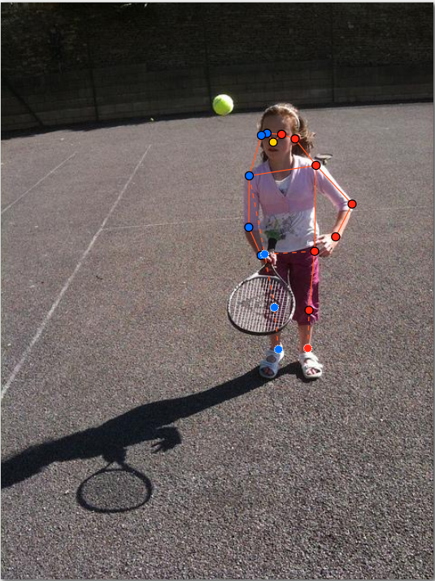
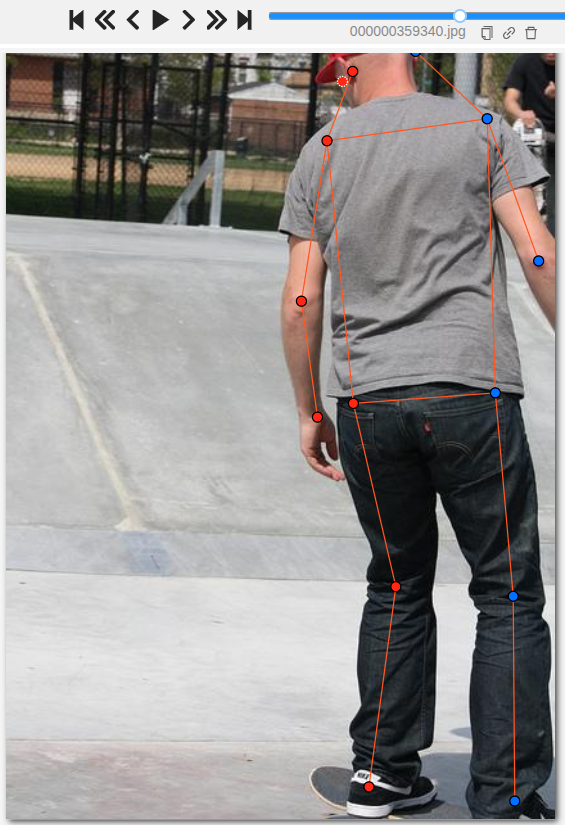
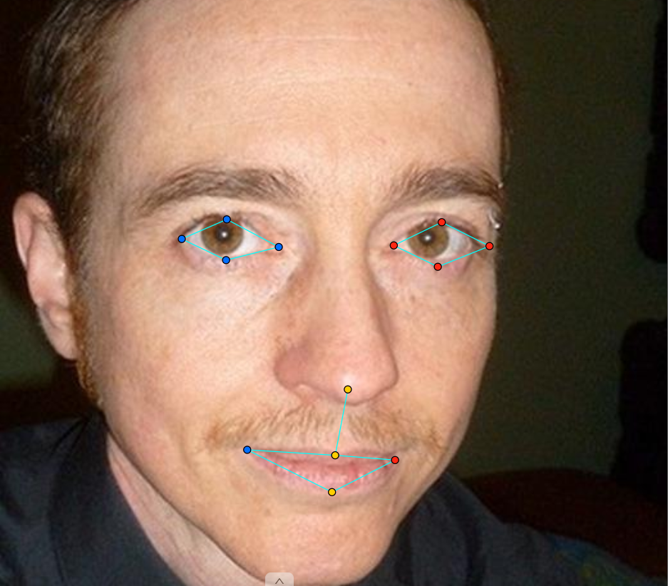
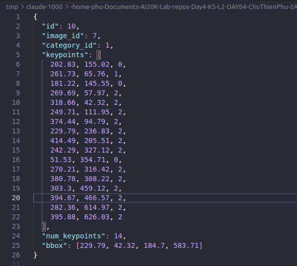

# Báo cáo cá nhân — ChuThienPhu-2A202603114

Dữ liệu: 12 ảnh người COCO 2017 (Lin et al., 2014) và 8 ảnh khuôn mặt cắt từ ảnh COCO (CC BY / CC BY-SA), chỉ dùng trong lớp.

## 0. Thông tin học viên

- Họ tên: Chu Thiên Phú
- MSSV: 2A202603114
- Email: 26ai.phuct@vinuni.edu.vn
- Link repository: https://github.com/chuphu2004/K5-L2-DAY04-ChuThienPhu-2A202603114-KeypointPose
- Phiên bản CVAT (Help → About): 2.74.1
- Máy: hệ điều hành Ubuntu 22.04.5 LTS · RAM 15 GB · chạy CVAT chế độ đầy đủ
- Bộ ảnh (`src/exports/assignment.json` do `lab.py setup` tạo): có
- Giờ bắt đầu: 16h30
- Giờ kết thúc: 19h

## 1. Kiểm tra label (CP0)

| Label | Kiểu | Số điểm | Tên điểm đúng bảng của lab? | Đúng thứ tự? | Số cạnh |
|---|---|---:|---|---|---:|
| `person` | Skeleton | 17 | Có | Có | 19 |
| `face` | Skeleton | 13 | Có | Có | 13 |

Mẫu `person` dựng theo người quay mặt về camera (các điểm `left_*` nằm bên phải khung mẫu)? Có

Cách đổi cờ `occluded` / `outside` cho **một điểm** trên phiên bản CVAT này (một câu):

Rê chuột vào đúng điểm cần đổi (điểm sáng lên) rồi bấm `Q` để bật/tắt `occluded` hoặc `O` để bật/tắt `outside` (hoặc chuột phải vào điểm để mở menu); chỉ điểm đó đổi, không dùng `H` (hidden) vì không được lưu.

## 2. Số lượng đã gán và thời gian (CP1, CP2)

| Nhóm ảnh | Số ảnh | Số skeleton đã gán | Số người dưới 60 px (không gán) | Số poster / gương / màn hình bỏ qua |
|---|---:|---:|---:|---:|
| `easy` | 5 | 5 | 0 | 0 |
| `occluded` | 3 | 7 | 0 | 0 |
| `back` | 2 | 3 | 1 (000000461002: người đứng trên đỉnh đồi) | 0 |
| `small` | 1 | 2 | 0 | 0 |
| `crowd` | 1 | 3 | 3 (000000381889: người ngồi phía sau cô dâu, khách ở xa) | 0 |
| `faces` | 8 | 8 | — | 0 |

Tổng: 21 skeleton `person` trong 12 ảnh (README ghi khoảng 20 người; cả 21 người đều là người thật, cao từ 91 px trở lên).

- Số ảnh người đã xong ở mốc phút 105: 10 / 10 (bắt đầu 16h30, xong đủ 12 ảnh người khoảng 18h20)
- Thời gian thực tế: tổng khoảng 150 phút (16h30–19h), gồm gán 12 ảnh người, 8 ảnh mặt, tự review và báo cáo
- Ảnh tốn thời gian nhất là ảnh nào, vì sao?

000000381889 (`crowd`): ba người đứng sát và che nhau, người phía sau bị cô dâu che một phần thân, phải lần theo từng chi từ vai ra để không gán nhầm tay của người này sang người khác, và quyết định từng điểm bị che là `v = 1` hay `v = 0`.

## 3. Bảng ca khó (CP1, CP2)

Mỗi điểm bạn phân vân một dòng, nhất là phân vân giữa `v = 1` và `v = 0`, hoặc không chắc hướng người.

| Ảnh | Người / mặt | Điểm | Cờ đã chọn | Phân vân giữa | Lý do chọn |
|---|---|---|---:|---|---|
| face_309728 | mặt | 8 điểm `left_eye_*`, `right_eye_*` | 1 | 1 / 0 | Kính râm tối che mắt nhưng ước lượng chắc theo gọng kính → `occluded`, không `outside` |
| face_560526| mặt | 8 điểm `left_eye_*`, `right_eye_*` | 0 | 1 / 0 | Mũ len che kín cả hai mắt, không có gọng hay khóe mắt để ước lượng → `outside` |
| face_309728.jpg| mặt | `*_eye_upper`, `*_eye_lower` | 2 | vị trí mí trên | Mắt nhắm: mép mí trên chạm mép mí dưới nên đặt hai điểm sát nhau trên đường khép mi (tỉ số mở mắt ≈ 0), không đặt ở đỉnh cầu mắt |
| 000000461389 | người chỉ lộ chân (#17) | 11 điểm phần trên | 0 | 1 / 0 | Hoàn toàn không nằm trong ảnh, chọn v=0 |
| 000000193879 | người phía sau (#6) | 10 điểm | 0 | 1 / 0 | Chỉ lộ những phần đã label, những phần còn lại không có dữ liệu gì để đoán |
| 000000162046 | người | right_ankle| 2 | 0 / 2 | gần như toàn bộ chân ở ngoài ảnh, vẫn có 1 chút gót chân ở trong ảnh, nên chọn v=2|

## 4. Bảng tự review (CP3)

Đi từ ảnh cuối về ảnh đầu. 5 ảnh người (ít nhất 2 ảnh `back` hoặc `crowd`) và 3 ảnh mặt. Ít nhất 8 dòng, kể cả dòng `ok`. Ghi lỗi trước, sửa sau.

Mã lỗi dùng đúng một trong: `lr_swap`, `vis_flag`, `position`, `missing`, `extra`, `ok`.

| Ảnh | Người / mặt | Điểm | Mã lỗi | Ghi chú | Đã sửa? |
|---|---|---|---|---|---|
| 000000580257 (`occluded`) | người #1 | `left_ankle`, `right_ankle` | `ok` | Script cảnh báo cặp ankle ngược phía; đã kiểm: chân bắt chéo thật, tên trái/phải đúng theo người | Không cần sửa |
| 000000461389 (`occluded`) | người chỉ lộ chân | 6 điểm chân | `ok` | Đã kiểm trái/phải của chân theo hướng người: đúng | Không cần sửa |
| 000000461002 (`back`) | em bé thả diều | toàn bộ | `ok` | Đã kiểm vị trí các khớp: đúng tâm khớp | Không cần sửa |
| 000000381889 (`crowd`) | người lộ mặt giữa 2 người | — | `ok` | Người chỉ lộ mặt giữa hai người chính cao dưới 60 px nên không gán, không tính là `missing` | Không cần sửa |
| 000000359340 (`back`) | người quay lưng | `right_ankle` | `vis_flag` | Cổ chân phải nằm trong ảnh, nhìn thấy được nhưng đã để `outside` (v=0); đúng phải là v=2 | Có |
| face_560526 (tóc/mũ che) | mặt | 8 điểm mắt | `ok` | Mũ che kín vùng mắt, không ước lượng được → v=0 đúng | Không cần sửa |
| face_309728 (kính râm) | mặt | 8 điểm mắt | `ok` | Mắt sau kính râm (có vẻ đang nhắm): v=1, đặt theo gọng, mí trên và mí dưới đặt gần nhau | Không cần sửa |
| face_168953 (kính trong) | mặt | 8 điểm `left_eye_*`, `right_eye_*` | `vis_flag` | Kính trong, mắt vẫn thấy được nhưng đã đặt `occluded` (v=1); theo guideline kính trong phải là v=2 | Có |

Tổng hợp số lỗi theo mã:

| `lr_swap` | `vis_flag` | `position` | `missing` | `extra` | `ok` |
|---:|---:|---:|---:|---:|---:|
| 0 | 2 | 0 | 0 | 0 | 6 |

Điểm còn phân vân giữa `v = 1` và `v = 0` (ghi cả hai lựa chọn và lý do chọn):

- face_309728, 8 điểm mắt: chọn v=1 thay vì v=0 vì gọng kính râm cho biết chắc vị trí và bề ngang mắt; chỉ độ mở mắt (mắt nhắm hay mở) là không thấy, nên đặt mí trên và mí dưới gần nhau.

## 5. Kiểm file xuất và kết quả tự kiểm (CP4)

Tự kiểm tay trong file JSON:

| File | Người / mặt kiểm (ảnh, thứ tự) | Số phần tử `keypoints` | Điểm `outside` ra `v = 0`, `occluded` ra `v = 1`? | `num_keypoints` khớp? |
|---|---|---:|---|---|
| `ChuThienPhu_persons.zip` | 000000193879, annotation #6 (người phía sau) | 51 | Có (v=2: 5, v=1: 2, v=0: 10) | Có (7) |
| `ChuThienPhu_persons.zip` | 000000359340, annotation #10 (người quay lưng) | 51 | Có (v=2: 13, v=1: 1, v=0: 3) | Có (14) |
| `ChuThienPhu_faces.zip` | face_309728 (kính râm) | 39 | Có (8 điểm mắt v=1, 5 điểm còn lại v=2) | Có (13) |

Sau khi xuất, CVAT ghi `occluded` thành `v = 1` và `outside` thành `v = 0`. Tọa độ của điểm `outside` trong file là `0, 0` hay tọa độ cũ? Tọa độ cũ (CVAT 2.x xuất như vậy; điểm `v = 0` bị bỏ qua khi huấn luyện và khi chấm).

Hai job đã chuyển sang completed trên CVAT? Có

Dán phần **TÓM TẮT** in ra từ `src/check_submission.py`:

```text
- File person: ChuThienPhu_persons.zip
  Số ảnh: 12 · số skeleton `person`: 21 · mỗi annotation 51 số
  Skeleton theo ảnh: 000000106051=2, 000000162046=1, 000000175703=1, 000000193879=3, 000000194027=1, 000000196283=1, 000000359340=1, 000000381889=3, 000000431893=1, 000000461002=2, 000000461389=3, 000000580257=2
  Cờ v: v=2 252 (71%) · v=1 48 (13%) · v=0 57 (16%)
  num_keypoints trung bình: 14.3
- File face: ChuThienPhu_faces.zip
  Số ảnh: 8 · số skeleton `face`: 8 · mỗi annotation 39 số
  Skeleton theo ảnh: face_122747=1, face_145621=1, face_168953=1, face_223746=1, face_309728=1, face_3348=1, face_469647=1, face_560526=1
  Cờ v: v=2 85 (82%) · v=1 11 (11%) · v=0 8 (8%)
  num_keypoints trung bình: 12.0
- Ghi chú: 65 điểm v = 0 vẫn mang tọa độ cũ (CVAT 2.x xuất như vậy; chuẩn COCO ghi 0, 0). Không phải lỗi: điểm v = 0 bị bỏ qua khi huấn luyện và khi chấm.
- Số [LỖI]: 0 · số [CẢNH BÁO]: 2
Kết quả: ĐẠT (đọc lại từng cảnh báo ở trên)
```

Các `[CẢNH BÁO]` còn giữ nguyên và lý do:

- `000000193879.jpg #1`: cặp ankle nằm ngược phía so với các cặp còn lại. Đã kiểm lại: tay vợt đang bước lao người đỡ bóng, một chân bước chéo qua chân kia nên cổ chân bắt chéo thật, tên trái/phải đúng theo người → giữ nguyên.
- `000000580257.jpg #1`: cặp ankle nằm ngược phía so với các cặp còn lại. Đã kiểm lại: người ngồi trên ghế băng vắt chéo chân nên cổ chân bắt chéo thật, tên trái/phải đúng theo người → giữ nguyên.

## 6. Ảnh chụp màn hình

1. Label `person` trong label constructor (đủ 17 điểm có tên):

   

2. Một người quay lưng đã gán, cờ đã đặt:

   

   Nguồn ảnh: COCO 2017.

3. Một khuôn mặt đã gán 13 điểm, phóng to vùng mắt:

   

   Nguồn ảnh: COCO 2017.

4. Một đoạn JSON xuất của một người:

   

## 7. Tự đánh giá

1. Lỗi bạn mắc nhiều nhất hôm nay, và cách bạn sẽ tránh ở dự án thật:

   đặt sai vị trí của ankle do hiểu nhầm, đặt nhầm vị trí elbow do chưa hiểu rõ. Đã sủa trong quá trình làm, chứ không cần check lại

2. Một quy tắc bạn đề xuất thêm vào guideline (kèm ảnh ví dụ nếu có):

   Thêm quy tắc cho **mắt nhắm** ở bộ 13 điểm: `*_eye_upper` và `*_eye_lower` đặt sát nhau trên đường khép mi, `v = 2`, không đặt mí trên ở đỉnh cầu mắt. Guideline hiện chỉ nói "mép mí", nên người gán dễ hiểu khác nhau, làm sai tỉ số mở mắt mà hệ thống giám sát tài xế cần.

3. Nhãn của bạn đi vào model ở đâu? Chọn một lỗi bạn đã sửa và nói nó sẽ làm model học sai thế nào (heatmap, trọng số trong loss, hay bước lật ảnh):

   Nhãn đi vào model ở ba chỗ: mỗi điểm `v > 0` thành một đỉnh heatmap tại tọa độ đã đặt; cờ `v` quyết định trọng số trong loss (`v = 0` có trọng số 0, `v = 1` và `v = 2` có trọng số 1); tên trái/phải được đổi chéo khi lật ảnh để tăng dữ liệu.

   Lỗi đã sửa: ảnh 000000359340, `right_ankle` của người quay lưng nằm trong ảnh, nhìn thấy được nhưng đã để `outside` (v = 0) (`vis_flag`). Nếu để nguyên, điểm này có trọng số 0 trong loss: model không có heatmap cổ chân cho người này và không bị phạt dù đoán cổ chân ở đâu, tức là mất một mẫu học đúng, lại đúng ở ca khó (người quay lưng) vốn ít dữ liệu. Khi chấm OKS, điểm này cũng bị bỏ qua nên đánh giá model trên cổ chân kém chính xác hơn. Lỗi ngược lại (điểm không thấy mà để v = 1, v = 2) còn tệ hơn: model bị ép học theo vị trí đoán bừa.

## 8. Khó khăn và lỗi kỹ thuật

- `python lab.py check` phát hiện tên `nuclio` bị trỏ sang 172.19.0.20 (lỗi giao diện kẹt "Connecting..."); script tự thêm `docker-compose.override.yml` trỏ nuclio về 127.0.0.1 và khởi động lại `cvat_server`. Sau đó CVAT chạy bình thường.

## Bonus (nếu làm)

### B1 — 3 ảnh người khó thêm

| Ảnh | Số skeleton | Số người dưới 60 px | Ca khó nhất |
|---|---:|---:|---|
| | | | |
| | | | |
| | | | |

Kết quả `src/check_submission.py` cho `ChuThienPhu_bonus_persons.zip`:

```text
(dán ở đây)
```

### B2 — 5 ảnh khuôn mặt đen trắng / hồng ngoại

Ảnh không màu khó hơn ở điểm nào? Kính râm trên ảnh hồng ngoại có còn là `v = 1` không?

...

### B3 — Model so với nhãn của tôi (không tính điểm)

- Demo đã dùng:
- Ảnh đã thử:

1. Model có trả điểm cho khớp bị che, hay khớp ngoài ảnh không? Confidence ở các điểm đó thế nào?

   ...

2. Với người quay lưng, model có đổi trái/phải không?

   ...

3. Bộ điểm của model có giống 17 điểm COCO không?

   ...


## 9. Tài liệu tham khảo và công cụ AI đã dùng

- `docs/GUIDELINE.md`, `docs/CVAT_CHEATSHEET.md`, `CHECKPOINTS.md` của lab.
- Claude Code: chạy `lab.py check`, tóm tắt guideline và hướng dẫn thao tác CVAT, giải đáp ca khó (kính râm, mắt nhắm, mắt không xác định được, điểm ngoài ảnh, vị trí khuỷu tay / hông / cổ chân), kiểm số liệu file xuất và soạn khung báo cáo. Việc gán nhãn và tự review do tôi tự làm trên CVAT.
